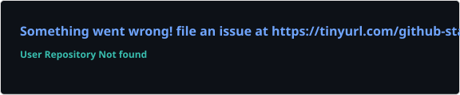

<!-- ===================== HEADER ===================== -->

  

  
  
  
  
  

  

  
  
  
  
  

##  About Me

<table>
  <tr>
    <td width="58%" valign="top">
       
      

        
        &nbsp;<b>Software Engineer</b> @ <b>ODDS Team</b> 🇹🇭 
        &nbsp;&nbsp;&nbsp;&nbsp;&nbsp;&nbsp;&nbsp;&nbsp;Fusion team building next-gen investment products
      

      

        
        &nbsp;Ex <b>Co-Founder &amp; CTO</b> @ <a href="https://dna-center.thaibioscience.com/">Thaibioscience</a>
      

      

        
        &nbsp;Fullstack · DevSecOps · Data Engineering · IoT
      

      

        
        &nbsp;Writing DevSecOps guides &amp; vuln research on <a href="https://medium.com/@kantapit9">Medium</a>
      

      

        
        &nbsp;Space nerd — still waiting for my ticket to Mars
      

      

        
        &nbsp;<i>“Build systems that solve real-world problems.”</i>
      

    </td>
    <td width="42%" align="center" valign="middle">
      
    </td>
  </tr>
</table>

🇹🇭 <b>ภาษาไทย</b> (คลิกเพื่อเปิด)

 

สวัสดีครับ ผม **พิชญ์** 👋 — ปัจจุบันเป็น Software Engineer ที่ **ODDS Team** 🇹🇭
ทำงานร่วมกับ Fusion Team ที่มุ่งพัฒนาผลิตภัณฑ์ด้านการลงทุนรุ่นใหม่
ก่อนหน้านี้เคยเป็นผู้ร่วมก่อตั้งและ CTO ที่ [Thaibioscience Co.,Ltd](https://dna-center.thaibioscience.com/)

ชอบเขียนโค้ด 👨‍💻 สนุกกับการลองเทคโนโลยีใหม่ ๆ หลงใหลเรื่องอวกาศ 🚀
และชอบสร้างระบบที่ช่วยแก้ปัญหาในโลกจริง

##  Featured Projects

<table>
  <tr>
    <td width="50%" valign="top">
      
    </td>
    <td width="50%" valign="top">
      <h3> Kong Gateway Custom Plugin</h3>
      Example custom plugin for Kong Gateway — extend your API gateway your way.
        
      
      
    </td>
  </tr>
  <tr>
    <td width="50%" valign="top">
      <h3> Dental Booking System Private</h3>
      Fullstack solution for clinic scheduling &amp; reporting.
        
      
      
    </td>
    <td width="50%" valign="top">
      <h3> Trivy Playground</h3>
      Example DevSecOps pipeline using Trivy &amp; GitHub Actions.
        
      
      
    </td>
  </tr>
</table>

##  Tech Arsenal

<table>
  <tr>
    <td align="center" width="170"> <b>Web</b></td>
    <td>
       
      
    </td>
  </tr>
  <tr>
    <td align="center"> <b>Mobile</b></td>
    <td>
       
      Flutter · React Native
    </td>
  </tr>
  <tr>
    <td align="center"> <b>DevOps / DevSecOps</b></td>
    <td>
       
      
      
      
      
    </td>
  </tr>
  <tr>
    <td align="center"> <b>Data Engineering</b></td>
    <td>
       
      
      
      
      
      
      
    </td>
  </tr>
  <tr>
    <td align="center"> <b>Testing</b></td>
    <td>
      
      
    </td>
  </tr>
  <tr>
    <td align="center"> <b>Competencies</b></td>
    <td>
      
      
      
      
    </td>
  </tr>
</table>

##  GitHub Galaxy

  
  

  

##  Contribution Snake

  <picture>
    <source media="(prefers-color-scheme: dark)" srcset="https://raw.githubusercontent.com/kantapit123/kantapit123/output/github-snake-dark.svg" />
    <source media="(prefers-color-scheme: light)" srcset="https://raw.githubusercontent.com/kantapit123/kantapit123/output/github-snake.svg" />
    
  </picture>

  

  
  
  
  
  

<!-- ===================== FOOTER ===================== -->

  

